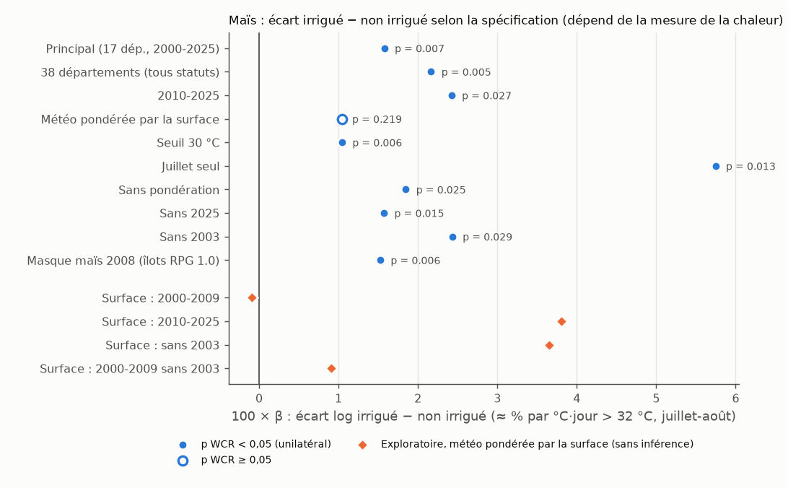
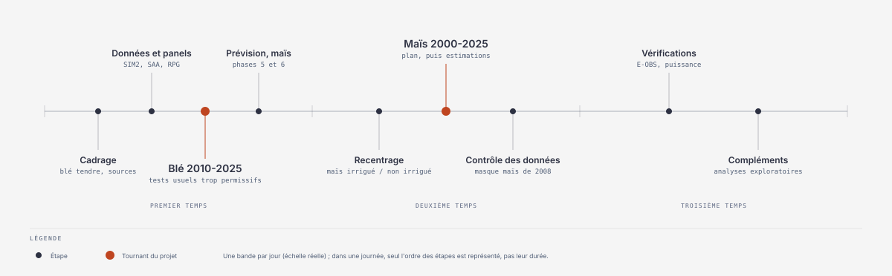
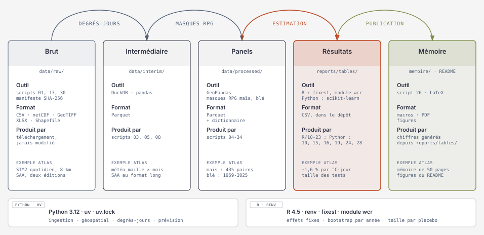
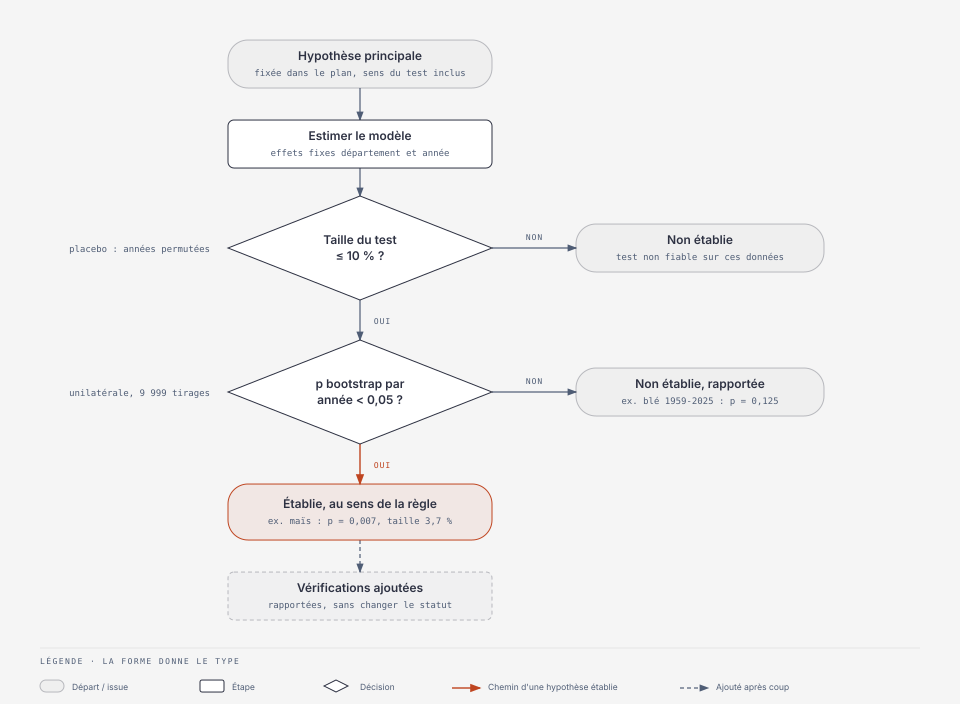
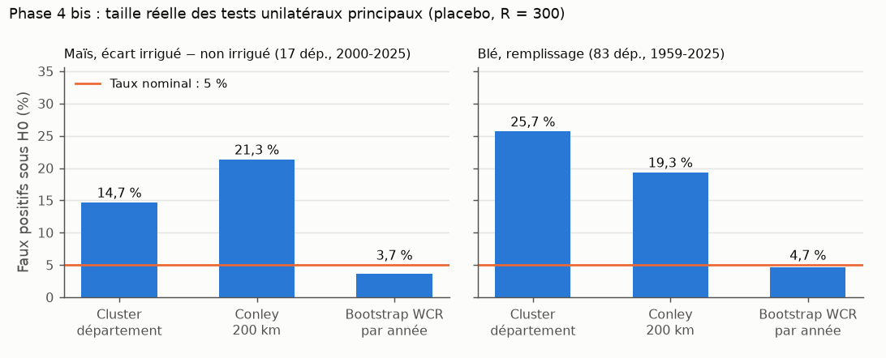
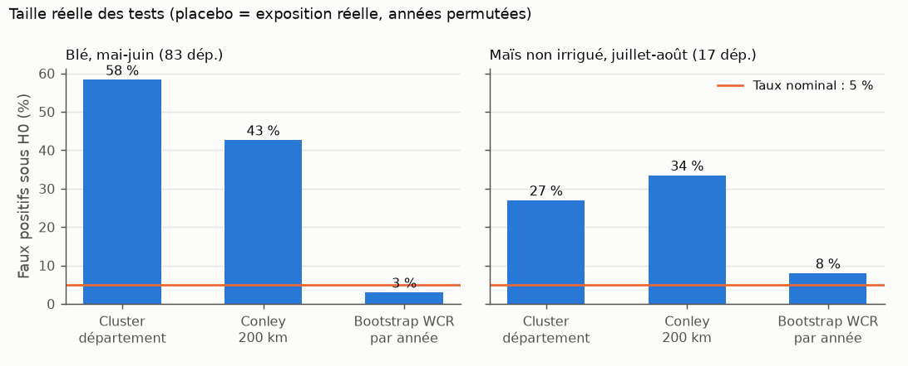
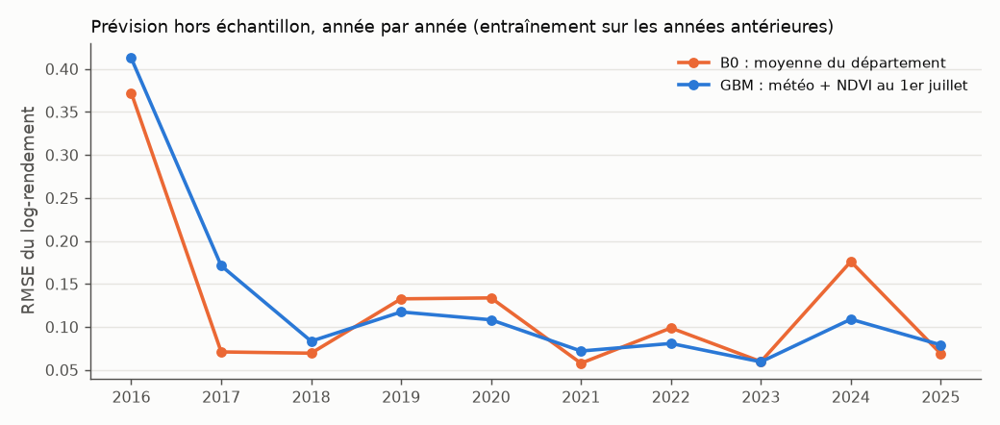
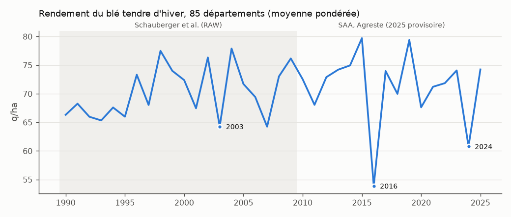

# ATLAS — Chaleur, irrigation et rendements agricoles en France

*Projet individuel de recherche appliquée : économétrie de panel, apprentissage automatique, données géospatiales et satellitaires. Python (ingestion, géospatial, prévision), R (économétrie), DuckDB (agrégation météo).*

> **En bref.**
> - **Maïs grain, 17 départements, 2000-2025 (résultat principal).** Chaque degré-jour au-delà de 32 °C en juillet-août est associé à un écart de rendement plus large d'environ **1,6 %** en faveur du maïs irrigué (bootstrap par année, p = 0,007, taille mesurée 3,7 %). Le signe est robuste, la significativité fragile : elle disparaît sans les six départements de relief (p = 0,152) ou avec une météo moyennée sur tout le département, et 62 % de l'échantillon vient des années qui ont suggéré l'hypothèse. C'est une association, pas un effet causal de l'irrigation.
> - **Blé tendre, 83 départements, 1959-2025.** La chaleur en fin de cycle est associée à −1,1 % de rendement par °C·jour, mais ce n'est **pas distinguable de zéro** (p = 0,125).
> - **Prévision.** Ni la météo ni le NDVI satellitaire ne battent de façon démontrée la moyenne historique du département.
> - **Test à venir.** Le test sur les récoltes 2026-2030 et la prévision du blé 2026 sont fixés dans [`specification_recoltes_futures.md`](specification_recoltes_futures.md), enregistrée sur OSF ([doi:10.17605/OSF.IO/QKNAV](https://doi.org/10.17605/OSF.IO/QKNAV)).
> - **Inférence.** Sur ces panels, le cluster par département et Conley concluent à tort dans 15 à 58 % des cas sans effet réel ; les inférences qui tiennent compte du choc commun à chaque année restent entre 3 et 12 %.



---

## 1. Questions et intérêt

Le projet s'est déroulé en deux temps.

<picture>
  <source media="(prefers-color-scheme: dark)" srcset="docs/figures/frise_projet_dark.svg">
  
</picture>

*La frise montre l'ordre des étapes, pas leur durée.*

**Premier temps (phases 0-7) : blé tendre d'hiver, 2010-2025.** Quel est l'effet des chocs de chaleur et de déficit hydrique du sol pendant les phases critiques sur le rendement départemental ? La météo, et le NDVI, connus au 1er juin ou au 1er juillet prévoient-ils le rendement mieux qu'une référence naïve ? L'effet de la chaleur sur le blé français est déjà établi sur 1950-2015 (Gammans, Mérel & Ortiz-Bobea 2017) : ATLAS en était une extension ciblée.

Résultat : l'association est négative mais non établie, faute d'information (16 récoltes).

**Second temps (phases 0 bis à 5 bis) : recentrage sur deux questions mieux identifiées.**

- **Q1 (principale) :** la chaleur creuse-t-elle l'écart de rendement entre maïs grain irrigué et non irrigué, dans un même département et une même année ?
  - La comparaison intra-département et intra-année absorbe les différences stables entre départements (sol, pratiques) et les chocs communs aux deux modes une même année ; elle ne neutralise pas une interaction entre ces différences et la chaleur.
  - L'interprétation reste associative : les parcelles irriguées diffèrent des autres.
  - Littérature : Schauberger et al. 2017 ; Li & Troy 2018 ; Zaveri & Lobell 2019 ; Tack et al. 2017.
- **Q2 (secondaire) :** sur 67 récoltes de blé (1959-2025), la chaleur en fin de cycle réduit-elle le rendement, et la sensibilité a-t-elle changé (adaptation) ?

## 2. Données et licences

| Source | Usage | Licence |
|---|---|---|
| **Agreste**, Statistique agricole annuelle, séries départementales 2010-2025 | Rendements, surfaces (blé ; maïs irrigué et non irrigué) | Réutilisation libre avec mention « Source : Agreste » (vérifié sur le site du producteur) |
| **Agreste**, SAA « anciennes séries » 2000-2020 (`SAANR_DEVELOPPE_2`) | Maïs grain irrigué et non irrigué 2000-2009 | Idem |
| **Météo-France**, SIM2 quotidienne (SAFRAN-ISBA, 8 km), août 1958-2025 | Température, précipitations, ETP, humidité du sol (SWI) | Licence Ouverte 2.0 |
| **IGN**, ADMIN EXPRESS COG CARTO 2026 | Contours départementaux | Licence Ouverte 2.0 |
| **IGN / ASP**, RPG 2015-2017 (parcelles) et RPG 1.0 2008 (îlots, 4 régions) | Masques blé (`BTH`) et maïs grain (`MIS`) ; masque maïs d'époque (robustesse) | Licence Ouverte 2.0 |
| **IGN**, service de calcul altimétrique (RGE ALTI) | Altitude des mailles (robustesse « montagne ») | Etalab 2.0 |
| **Schauberger et al. 2022**, GFZ (version RAW) | Rendements de blé 1959-2009 | CC-BY 4.0 |
| **MTE**, VigiEau « Donnée Sécheresse » (data.gouv.fr) | Arrêtés de restriction d'eau 2012-2025 | Licence Ouverte 2.0 |
| **INSEE**, IPPAP blé tendre et maïs + **Eurostat** `apri_ap_crpouta` | Prix (valorisation descriptive) | Licence Ouverte 2.0 (INSEE) ; réutilisation avec mention de la source (Eurostat) |
| **NASA LP DAAC**, MOD13Q1 v6.1 via AppEEARS | NDVI 250 m (prévision) | CC0, citation demandée (Didan 2021, DOI 10.5067/MODIS/MOD13Q1.061) |
| **NASA LP DAAC**, MOD11A2 v6.1 via AppEEARS | Température de surface de jour, 1 km, juillet-août 2000-2025 (vérification) | CC0, citation demandée (Wan, Hook et Hulley 2021, DOI 10.5067/MODIS/MOD11A2.061) |
| **ECA&D / Copernicus**, E-OBS v33.0e (0,1°), 2000-2025 | Tmin et Tmax : vérification de la mesure de chaleur du maïs | Recherche et enseignement non commerciaux ; citation de Cornes et al. 2018 (DOI 10.1029/2017JD028200) obligatoire |
| **OFB / agences de l'eau**, BNPE via l'API Hub'Eau (usage irrigation, 2012-2023) | Volumes prélevés pour l'irrigation (vérification) | Licence Ouverte 2.0, citation du producteur |
| **Agreste**, Recensement agricole 2020 (RA2020_0052) | Part du maïs grain dans les surfaces irriguées | Réutilisation libre avec mention de la source |
| **DRIAS**, Explore2-Climat 2022 corrigé ADAMONT (17 simulations) et **DRIAS-Eau** (SWI mensuel) | Chaleur, VPD et humidité du sol projetés (discussion) | Licence Etalab (conditions des portails DRIAS) ; compte personnel |
| **Agreste**, Conjoncture grandes cultures n° 2026-131 et **Météo-France**, SIM2 2026 | Pré-lecture de la récolte 2026 | Comme la SAA ; Licence Ouverte 2.0 |

**Reproductibilité des données :**

- les données brutes (≈ 50 Go d'après le manifeste, dont 21 Go de projections DRIAS) ne sont **pas versionnées** ;
- leurs URL, tailles et **SHA-256** sont dans `docs/manifest_raw.csv`, et `tests/test_manifest.py` les vérifie ;
- les points d'attention de chaque source sont détaillés dans `docs/sources.md`. La SAA 2000-2009 a été localisée par exploration du site Agreste (navigation automatisée en lecture seule), puis contrôlée : sur 2010-2020, 95 % des rendements concordent à 0,5 q/ha près avec les séries actuelles (1 674 paires comparées).

## 3. Architecture et flux de données

<picture>
  <source media="(prefers-color-scheme: dark)" srcset="docs/figures/pipeline_atlas_dark.svg">
  
</picture>

*Chaque étage n'est produit que par des scripts, à partir de l'étage précédent ; `data/` reste hors du dépôt, `reports/tables/` y figure. Diagramme généré par `scripts/32_diagrammes_readme.py` (mise en page « Medallion » de [diagram-design](https://github.com/cathrynlavery/diagram-design), MIT).*

| Technologie | Rôle |
|---|---|
| **Python** | `src/atlas/` (download, saa, spatial, degree_days, weather, rpg, forecast…) et `scripts/` numérotés |
| **R** | Économétrie (`fixest`) et un wild cluster bootstrap implémenté dans le projet, sous forme de **module réutilisable** `R/wcr/` (test, test joint, taille par placebo, exemple simulé autonome), `fwildclusterboot` ayant été retiré de CRAN. Validation : statistique t comparée à `fixest`, simulations de taille sur chaque jeu de données et 25 contrôles automatisés (`Rscript tests/test_r_inference.R`) |
| **DuckDB** | Lecture directe des 68 fichiers csv.gz de SIM |
| **Interface entre langages** | Parquet ; les variables sont définies dans l'annexe B du mémoire |

## 4. Choix méthodologiques

Chaque phase d'estimation a commencé par un plan écrit (échantillon, variables, sens des tests, robustesses). Certains ajouts (tests de taille, robustesses blé R11-R14, comparaison des prévisions à B0) ont été définis après les premiers résultats ; ils sont listés comme tels dans l'annexe C du mémoire.

- **Exposition :**
  - degrés-jours par double sinus entre Tmin et Tmax, calculés **au niveau maille-jour puis agrégés** ;
  - convention de date de `TINF_H` / `TSUP_H` établie empiriquement ;
  - pondération par un **masque de parcelles RPG** fixe (2015-2017) : blé `BTH`, ou maïs `MIS`. Le code `MIS` correspond bien au maïs grain : corrélation départementale de 0,993 avec la surface SAA.
- **Q1, maïs :**
  - écart log irrigué − log non irrigué ~ effets fixes département et année + degrés-jours > 32 °C et SWI de juillet-août ;
  - poids : surface de maïs 2010-2012 (fixe) ;
  - échantillon principal : 17 départements de statut qualité 1. Le statut de 2025 est appliqué à 2000-2009, faute de statut publié avant 2010 ;
  - une hypothèse principale (test unilatéral), quatre hypothèses secondaires corrigées par Holm, 8 robustesses ;
  - les années 2000-2009, que l'analyse exploratoire n'avait pas utilisées, servent de réplication.
- **Q2, blé 1959-2025 :**
  - spécification M1 de la phase 4, avec des effets fixes **département × période de source** (1959-1988, 1989-2009, 2010-2025) pour absorber les ruptures de série ;
  - pentes de chaleur par période de 22-23 ans pour la question de l'adaptation.
- **Blé 2010-2025 (phase 4) :** log(rendement) ~ effets fixes département et année + degrés-jours de croissance et extrêmes (mai-juin) + pluie de printemps + chaleur et pluie d'automne. Estimand : association de court terme avec un choc météo, pas effet du changement climatique.
- **Inférence et règle de décision (schéma ci-dessous) :**
  - **wild cluster bootstrap restreint par année** (poids de Webb) ;
  - sa taille est vérifiée par simulation sur les données de chaque question (placebo = champ d'exposition réel à années permutées) ;
  - le cluster par département et Conley 200 km sont rapportés pour information ; le tableau des tailles compare aussi le cluster par année, le cluster à deux dimensions et Driscoll-Kraay.

<picture>
  <source media="(prefers-color-scheme: dark)" srcset="docs/figures/regle_decision_dark.svg">
  
</picture>

- **Prévision :**
  - origine glissante (entraînement 2010…*t*−1, test *t* = 2016-2025) ;
  - moyennes, tendance, standardisation et hyperparamètres estimés **dans le pli** ;
  - variables tronquées à la date de prévision ;
  - tests automatiques d'absence de fuite.

## 5. Résultats obtenus

### 5.1 Maïs : chaleur associée à un écart plus large en faveur de l'irrigué (sensible à la mesure) (`docs/resultats_phase4bis.md`)

17 départements, 2000-2025, 435 paires département-année irrigué / non irrigué.

| | Estimation | p WCR par année (unilatérale) |
|---|---|---|
| **H1 : écart irrigué − non irrigué, °C·jour > 32 °C** | **+1,6 % par °C·jour** | **0,007** (taille du test : 3,7 %) |
| Réplication sur 2000-2009 seulement (10 années) | +1,1 % (environ deux fois moins que sur 2010-2025) | 0,051 (bilatérale 0,10 ; taille 4,7 % à 10 grappes, mais puissance de 8 % seulement) |
| H2b : maïs non irrigué | −2,5 % | < 0,001 (Holm) |
| H2c : maïs irrigué | −1,0 % | 0,004 (Holm) |
| H2a : un sol plus humide est associé à un écart plus faible | −0,35 par unité de SWI | 0,026 (Holm) |
| H3 : les jours de « crise » VigiEau réduisent l'avantage de l'irrigué (2016-2025) | Signe **opposé** | 0,96 : non soutenue |

**Lecture de H1 :** « établie » au sens de la règle de décision du plan. 62 % des paires (2010-2025) sont les années dont l'analyse exploratoire a suggéré l'hypothèse ; la seule preuve nouvelle est la décennie 2000-2009, où la puissance du test n'est que de 8 % (72 % sur l'ensemble de la période).

- **Robustesse :** le signe est positif dans les 10 spécifications (figure ci-dessus) et significatif dans 9. Avec le masque maïs, exclure 2003 ou l'année provisoire 2025 ne change pas la conclusion, et l'élargissement à 38 départements non plus (+2,2 %).
- **Dépendance à la mesure de la chaleur :**
  - avec une météo pondérée par la surface du département plutôt que par les parcelles de maïs, le coefficient n'est **pas significatif** (p = 0,22) ;
  - ce n'est pas une simple atténuation par erreur de mesure : sur 2010-2025, cette mesure donne même un coefficient plus fort (0,038 contre 0,024). La divergence se concentre sur 2000-2009 (−0,0009 contre +0,011) et persiste sur 2000-2009 sans 2003 (0,009 contre 0,038) ;
  - la réplication 2000-2009 n'existe qu'avec le masque maïs, choisi après l'analyse exploratoire de la phase 6 ;
  - **un masque maïs d'époque (îlots RPG 2008) donne le même résultat** (+1,5 %, p = 0,006 ; robustesse ajoutée après les premières estimations). L'âge du masque n'explique donc pas la divergence ;
  - **avec une autre source de température, E-OBS** (même méthode, même masque), le résultat tient : +1,5 % par °C·jour, p = 0,004 ; les deux mesures sont corrélées à 0,95. E-OBS compte plus de degrés-jours > 32 °C que SIM ; une partie de ses stations françaises alimente aussi SAFRAN, ce n'est donc pas une mesure entièrement indépendante ;
  - la divergence entre les deux mesures se concentre dans les départements de relief (Puy-de-Dôme, Isère, Drôme, Jura), où le maïs pousse en plaine et en vallée. En 2003, la pondération surfacique y sous-estime la chaleur subie par la culture de 7,5 à 10,3 °C·jour. C'est une explication a posteriori, cohérente avec le choix du masque maïs comme mesure principale du plan.
- **Valorisation descriptive,** en euros courants, pour les 17 départements : les quintaux **associés** à l'irrigation lors d'un été plus chaud que la normale valent **de 21 à 49 M€ en 2003** : 49 M€ avec la formule linéaire au prix raccordé (16 à 172 M€ aux bornes de l'intervalle à 90 % de β), 21 M€ avec l'écart observé et le prix Eurostat de 2003 ; 9 M€ en 2019 et 14 M€ en 2022 avec la formule. C'est une valeur brute de production : ni la valeur totale de l'irrigation, ni une valeur nette du coût de l'eau, ni une valeur par m³ ou le coût d'une restriction, ni un gain causal. Aux poids de la valorisation, la formule dépasse de 89 % la valeur tirée de l'écart observé en 2003 (28 % hors des deux paires reprises de 2002), mais elle donne moins que l'écart observé en 2019 et 2022.
- **Mesure du partage irrigué / non irrigué :** dans la SAA, le rendement non irrigué est souvent calculé à partir de la production, et l'ancienne série reconduit parfois le rapport d'une année sur l'autre. Le premier mécanisme pourrait gonfler l'écart, le second l'atténuer ; les vérifications (`docs/resultats_complements.md`, annexe C et § 10.2 du mémoire) ne montrent pas d'artefact, mais un double jugement d'expert ne serait pas détectable. C'est la principale limite de la variable expliquée.
- **Ce que ce résultat n'est pas :** un effet causal de l'irrigation. Les parcelles irriguées diffèrent des autres, et lors des sécheresses une partie du maïs non irrigué semé pour le grain peut être récoltée en ensilage (les surfaces abandonnées restent comptées, avec un rendement nul). La part irriguée de l'année ne varie pas de façon détectable avec la chaleur, mais l'ensilage n'est pas observé.

### 5.1 bis Analyses complémentaires (`docs/resultats_complements.md`)

Ajoutées après les estimations principales, exploratoires ; elles ne changent pas le statut de H1.

| Analyse | Résultat | Lecture |
|---|---|---|
| Inférence de H1 : jackknife par année (CV3), randomisation, DML (forêts aléatoires) | p = 0,074 ; 0,002 ; DML : β médian = 0,0134 sur 50 découpages en plis (p = 0,056) | La significativité dépend de la méthode ; le DML baisse β de 15 à 22 % et dépend du découpage et de la graine |
| Bootstrap de la statistique du CV3 | p = 0,019, taille 3,7 % | Le désaccord WCR / CV3 tient à la loi de référence, pas aux données |
| Levier de 2003 | 41 % (2000-2025), 80 % (2000-2009) | La réplication repose sur un été |
| Retrait de chaque année ; corrélation sérielle simulée | Significatif 26 fois sur 26 ; taille 5,0 à 8,0 % | La règle de décision tient |
| Hétérogénéité (relief, part irriguée, pentes rétrécies) | Aucune différence détectée (homogénéité calibrée par bootstrap par année : p = 0,26 ; le χ² usuel rejette à tort dans 99 % des placebos) | Les départements de relief apportent de l'information, pas une pente différente |
| **Réplication sur le maïs fourrage** (28 départements, 2010-2025) | +1,6 % par °C·jour, p = 0,005, taille 2,7 % ; sans les 50 couples au rapport du grain : +1,6 %, p = 0,007 | Même résultat sur une autre culture, mais statistiques en partie reprises du grain |
| **Déficit de pression de vapeur (VPD)** avec les degrés-jours | VPD +64 % par kPa (p = 0,002) ; degrés-jours −0,2 % (p = 0,76) ; corrélation 0,76 | Le résultat porte sur les étés chauds et secs ; chaleur extrême et air sec ne sont pas séparables (et le maïs fourrage ne confirme pas ce partage) |
| **Multivers** : 76 combinaisons de mesure, seuil, fenêtre, pondération, échantillon et 2003 | Toutes positives, 68 significatives ; les 8 autres utilisent la météo moyennée sur le département | Seule la mesure de la chaleur compte vraiment |
| Autres sources de chaleur : moyenne SIM2 / E-OBS ; température de surface MODIS | 1,6 % (p = 0,004) ; +4,2 % par °C (p = 0,002) | Même sens ; la température de surface reflète aussi le stress hydrique |
| Placebo : chaleur de l'été suivant ; placebo intra-année | p = 0,35 ; taille 4,0 % | Pas d'alerte |
| Partage SAA : rendements non irrigués calculés à partir de la production ; rapports reconduits d'une année sur l'autre | Calculés dans 53 % (2000-2009) et 57 % (2010-2025) des paires ; sans elles +4,1 % (p = 0,006) ; sans les rapports reconduits 1,8 % (p = 0,011), sans les 7 départements les plus touchés 1,0 % (p = 0,070) | Pas d'artefact détecté, mais un double jugement d'expert resterait indétectable |
| Ensilage (SAA maïs fourrage, 2010-2025) | Pas de hausse de la part ensilée les étés chauds (p = 0,43) | 2003 hors période |
| Volumes prélevés pour l'irrigation (BNPE, 2012-2023) | Suivent la sécheresse du sol (p < 0,001), pas la chaleur (p = 0,28) | L'eau utilisée suit les sols secs |
| Projections DRIAS (17 simulations Explore2, masque maïs) | Degrés-jours > 32 °C de l'été moyen : 1,3 (1976-2005) → 3,8 / 7,2 / 17,9 à +2,0 / +2,7 / +4,0 °C (2003 : 14,7) | Les étés qui portent le résultat deviendraient ordinaires ; à +4 °C, hors du support de β |
| Taille des inférences à composante temporelle | Cluster par année 5-10 %, deux dimensions 6-10 %, Driscoll-Kraay 8-12 % | Le défaut vient des inférences sans composante temporelle |
| Prévision : modèles d'arbres corrigeant B0 | +11 à +18 % sur B0 ; intervalle de Student incluant 0 dans les 4 cas | Piste à confirmer sur les récoltes 2026 et suivantes |

Les autres analyses (valeur du m³, variables instrumentales, forme de la relation…) sont dans `docs/resultats_complements.md`.



### 5.2 Blé 1959-2025 : association négative, non établie (`docs/resultats_phase4bis.md`)

| | Estimation | p WCR par année |
|---|---|---|
| Q2-H1 : degrés-jours > 32 °C en fin de cycle | −1,1 % par °C·jour | 0,125 (unilatérale ; taille 4,7 %) |
| Q2-H2 : égalité des pentes 1959-1981, 1982-2003, 2004-2025 | −0,1 %, −2,8 %, −1,1 % | 0,48 (test joint ; chaque pente repose sur un ou quelques étés : 1976, 2003, puis 2019-2025) |

- **Robustesse :** le signe est négatif dans les 6 spécifications ; une seule est significative, celle qui exclut 2025 (p = 0,024). Elle n'est pas retenue : choisir la variante qui « marche » après avoir vu les résultats serait une recherche de spécification.
- **Pourquoi « non établi » :** passer de 16 à 67 récoltes n'augmente le nombre effectif d'années informatives que de 4,1 à 6,2. Les chocs sont nationaux et rares.

### 5.3 Blé 2010-2025 (premier temps, `docs/resultats_phase4.md`)

| | Estimation | p, cluster département | p, Conley | p, WCR par année |
|---|---|---|---|---|
| M1 : degrés-jours > 32 °C, mai-juin | −0,0149 (≈ −1,5 % / °C·jour) | 0,004 | 0,047 | **0,378** |
| M2 : idem, à humidité du sol égale | −0,0152 | 0,007 | 0,111 | **0,331** |

Le signe est négatif dans 11 des 12 spécifications alternatives R1 à R13 qui changent le coefficient (R9 ne change que le seuil de Conley) et dans les 16 estimations *leave-one-year-out*. Mais sans aucun effet réel, le cluster par département conclut à tort dans **58 %** des cas et Conley dans **43 %**. Le bootstrap par année a la bonne taille (3,0 %), mais il ne détecte un vrai effet de −1,5 % que dans 9 % des cas. Le cluster par année ou à deux dimensions (taille 5,0 et 6,0 %) aurait aussi conclu à l'absence de preuve (p = 0,35 et 0,31).



### 5.4 Prévision : pas de gain démontré sur la moyenne du département (`docs/resultats_phase5.md`, `docs/resultats_phase6.md`)

- **La référence avec tendance (B1) prévoit moins bien que la simple moyenne du département (B0),** conséquence du plafonnement des rendements. Juger les modèles contre B1 aurait été trompeur.
- **Entraînement depuis 2010 :** tous les modèles (MCO, ridge, forêt aléatoire, gradient boosting) font **moins bien** que B0, de −14 % à −72 %.
- **Entraînement depuis 1990 :** ridge, forêt aléatoire et gradient boosting gagnent 7 à 20 % sur B0, mais l'intervalle contient 0.
- **Le NDVI** est associé à un gain positif pour les 6 combinaisons modèle × date (de +1,6 % à +27,7 % ; ce dernier tient surtout à la stabilisation du ridge), mais significatif dans une seule avec l'intervalle de Student sur 10 années (forêt aléatoire au 1er juin, et seulement avec la graine 123 ; 5 avec le bootstrap du protocole, trop étroit), et **sans battre B0** (variante principale seulement).



### 5.5 Autres résultats exploratoires (`docs/resultats_phase6.md`)

- **Maïs 2010-2025, météo pondérée par la surface (phase 6) :** −5,9 % par °C·jour pour le non irrigué. Cette analyse exploratoire a motivé le recentrage. La phase 4 bis la remplace : masque de parcelles, 26 années et hypothèses fixées dans le plan.
- **Valorisation du blé :** l'écart de production par rapport à une année normale vaut environ **1,9 Md€ en 2016** (−25,3 %) et **1,3 Md€ en 2024**. C'est un calcul descriptif, pas une perte attribuée à la météo.



## 6. Limites (à lire avant toute réutilisation)

- **Interprétation :** tous les résultats sont des associations ou des effets de court terme de chocs météo ; aucun n'est un effet causal de l'irrigation ni un effet du climat.
- **Maïs :**
  - dépendance du résultat à la mesure de la chaleur (§ 5.1) ;
  - statut qualité de 2025 appliqué à 2000-2009 ;
  - deux versions de la SAA raccordées en 2010 ;
  - masque de parcelles fixe (2015-2017 ; vérifié avec un masque 2008), qui ne distingue pas irrigué et non irrigué ;
  - partage irrigué / non irrigué de la SAA en partie calculé (rendement non irrigué dérivé de la production) ou reconduit ;
  - passage du grain à l'ensilage non observé en 2000-2009 ; sur 2010-2025, la part ensilée du maïs non irrigué ne varie pas avec la chaleur (l'abandon est compté avec un rendement nul) ;
  - VigiEau : indicateur grossier (« au moins une zone du département »), niveau de gravité incomplet avant 2016.
- **Blé :**
  - ruptures de source en 1989 et 2010, absorbées en niveau mais pas en pente ;
  - masque 2015-2017 appliqué à 1959 (anachronique) ;
  - 18 rendements manquants avant 1968 ;
  - fenêtres phénologiques fixes sur 67 ans, alors que les dates de semis et les variétés ont changé.
- **Rendements SAA :** synthèse multi-sources ; 86,6 % des rendements de blé 2010-2025 sont arrondis au quintal près (95,6 % sur 1990-2009) ; 2025 provisoire.
- **Météo :** SIM est une réanalyse (8 km) qui peut lisser les extrêmes locaux ; E-OBS, interpolé de stations, compte davantage de degrés-jours > 32 °C dans chacun des 17 départements (moyenne 2000-2025).
- **Prévision :** test en pseudo-temps réel (séries rétropolées, réanalyse météo, échantillon choisi avec le statut qualité de 2025) ; seulement 10 années test.
- **Absences :** pas de modèle de maladies (fusariose en 2016).

**Pistes :**

- un masque irrigué / non irrigué (le RPG utilisé ici n'enregistre pas l'irrigation ; une carte satellitaire de l'irrigation serait une piste, non évaluée ici) ;
- la température de surface séparément sur parcelles irriguées et non irriguées (refroidissement, Zhu et Burney 2022), avec une carte de l'irrigation ;
- confirmer sur les récoltes 2026 et suivantes les modèles de prévision corrigeant B0 ;
- documenter auprès du SSP la définition d'« irrigué » dans la SAA ;
- utiliser des fenêtres phénologiques modélisées ;
- refaire les estimations après la SAA définitive 2025.

## 7. Installation et reproduction

**Prérequis :**

- Linux ou WSL ;
- [uv](https://docs.astral.sh/uv/) (Python 3.12, installé par `uv`) ;
- R ≥ 4.5 ;
- `7zip` (archives RPG) ;
- environ 50 Go de disque pour les données brutes, plus les extractions du RPG et les fichiers intermédiaires ;
- pour le NDVI et la température de surface, un compte NASA Earthdata.

```bash
uv sync                                   # environnement Python (uv.lock)
Rscript -e 'renv::restore()'              # environnement R (renv.lock, binaires Posit Package Manager datés)
cp .env.example .env                      # NDVI uniquement : y renseigner APPEEARS_TOKEN (jamais versionné)
```

La chaîne complète, dans l'ordre, est détaillée dans **`data/README.md`**, y compris les étapes des phases 0 bis à 5 bis.

- **Durées indicatives :**
  - météo 1958-2025 : environ 20 min ;
  - masques RPG : environ 3 min chacun ;
  - Q1 : environ 1 min ; vérifications de `R/21` : environ 15 min ; analyses complémentaires (`R/22`) : environ 5 min ;
  - Q2 : environ 3 min (simulation de taille comprise) ;
  - prévision : 10 min ;
  - NDVI : de 1 à plusieurs heures côté NASA, puis environ 15 min d'agrégation et 30 min de prévision (`data/README.md`).
- **Tests :** `uv run pytest`. Ils couvrent les schémas, les clés, les cardinalités, les degrés-jours contre une intégration numérique, l'absence de fuite, la cohérence du masque maïs avec la SAA et l'intégrité des fichiers bruts.
  - 144 tests de logique et de données, plus une vérification d'empreinte par fichier brut (1 074) ; le module R a 25 contrôles (`Rscript tests/test_r_inference.R`).
  - Sans les données, les tests sur fichiers sont ignorés (*skip*).
- **Reproduction vérifiée :** sur une copie vierge du dépôt, toute la chaîne (69 étapes de `data/README.md`, sans les téléchargements) a été relancée depuis les fichiers bruts. Elle redonne les mêmes tables (à l'octet, sauf les modèles aléatoires en parallèle : écarts ≤ 2 × 10⁻¹⁴), les mêmes figures et les mêmes chiffres du mémoire (`numbers.tex` identique à l'octet), et les tests passent. Seule la vérification bibliographique (script 47, qui interroge Crossref) n'est pas rejouée.
- **Scripts R :** à lancer depuis la racine du dépôt (chemins relatifs ; `.Rprofile` active `renv`).
- **Graines :** fixées à 123 (graines dérivées : 123 + r), changées après les résultats ; les lectures qui changent avec la graine sont signalées comme sensibles. La prévision figée du blé utilise la graine `SEED_FIGEE` (`src/atlas/forecast.py`).

**Documents clés :**

- mémoire : `memoire/` (méthodes, variables, écarts au plan et reproduction en annexes) ;
- sources et licences : `docs/sources.md`, `NOTICE.md` ; manifeste des fichiers bruts : `docs/manifest_raw.csv` ;
- résultats : `docs/resultats_phase4.md` à `docs/resultats_phase6.md`, **`docs/resultats_phase4bis.md`** et `docs/resultats_complements.md` ;
- tests sur les récoltes futures : `specification_recoltes_futures.md`, enregistrée sur OSF (https://osf.io/qknav).

## 8. Licence et citation

- **Code** (`src/`, `scripts/`, `R/`, `tests/`) : licence MIT (`LICENSE`) ; détail par type de contenu dans `NOTICE.md`.
- **Texte du mémoire et documentation** : CC BY 4.0.
- **Tables et figures** : dérivées de sources publiques qui gardent leurs propres licences (`docs/sources.md`).
- **Citation** : `CITATION.cff`.
